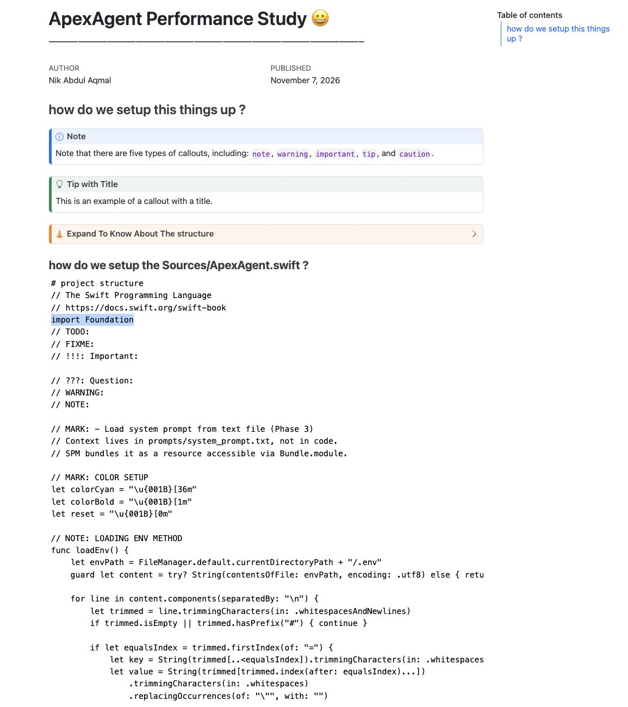

# ApexAgentNotebook

> Performance study notebooks for [ApexAgent](https://github.com/nickaqmal02/ApexAgent) — a macOS native voice agent built in Swift with local LLM inference.



## What's here

**`performance_study.qmd`** — A Quarto notebook investigating:

> Where does the time go in a local-first voice agent?

Per-stage latency breakdown of the ApexAgent pipeline (STT → LLM → tool execution → TTS), comparing **online mode** (GLM API + Deepgram) vs **offline mode** (Ollama + Qwen3 + Apple Speech). Per-command rows, not means — because means hide the failures.

## Tech stack

| Component | Tool |
|---|---|
| Notebook format | Quarto (.qmd) |
| Kernel | Python (conda: `jupyter_env`) |
| Analysis | pandas, matplotlib |
| Render target | HTML (publishable to GitHub Pages) |

## Quickstart

```bash
# activate the conda env
conda activate jupyter_env

# render once (static HTML)
quarto render performance_study.qmd

# or live preview (auto-refresh on save)
quarto preview performance_study.qmd
```

## Method

1. Instrument the Swift pipeline with stage-boundary timestamps → JSONL logs
2. Run N spoken commands per mode (online + offline), same command set
3. Analyze per-stage latency, per-command — means hide, rows reveal
4. Verdict: ship / fix / remove, with tripwire conditions

## Author

**Nik** (@nickaqmal02) — Final-year CS @ UPNM. AI Engineer in training.
ApexAgent: built from scratch in Swift, no Xcode, terminal-first, one week.
